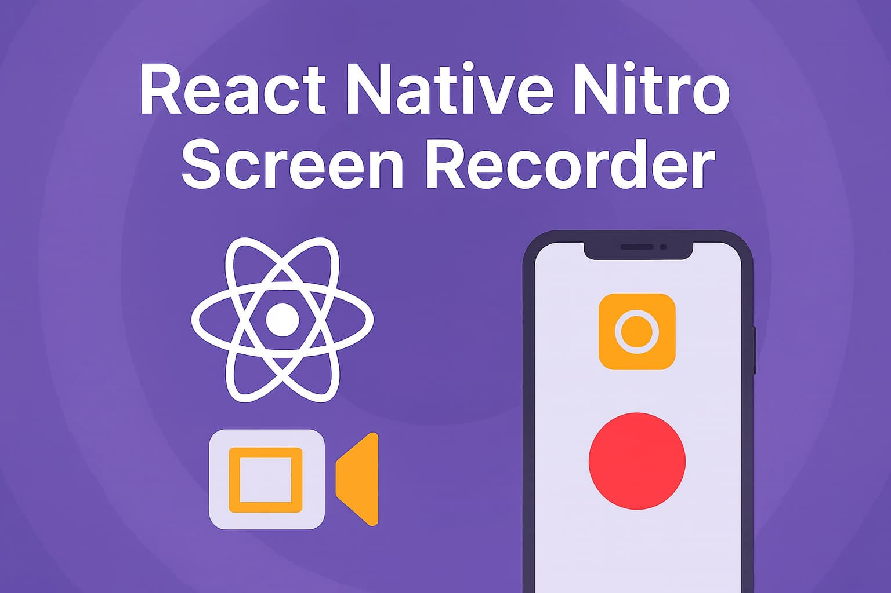
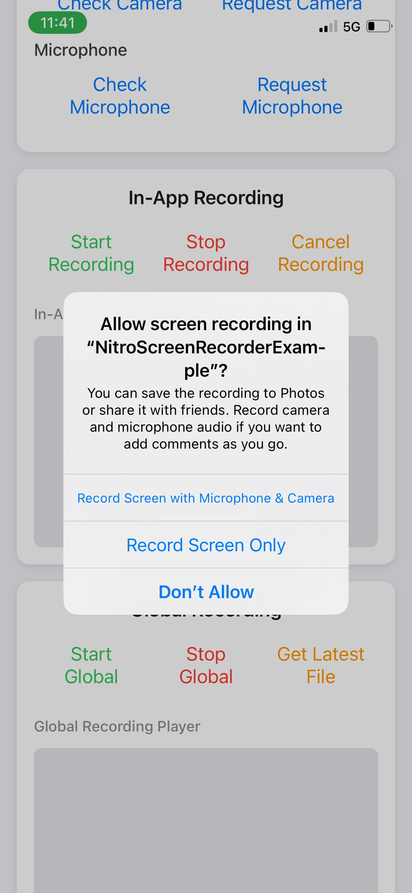
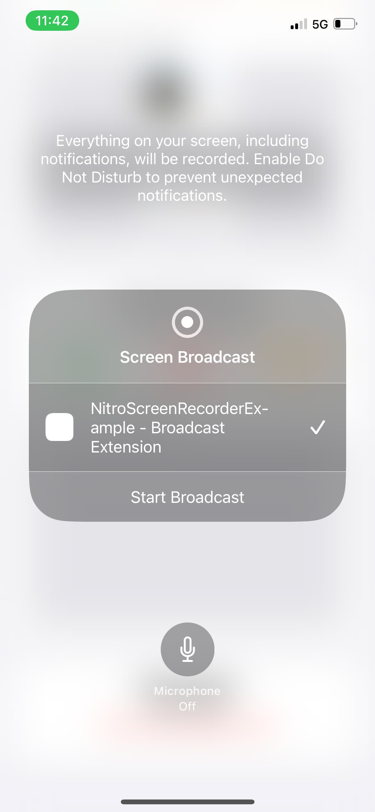
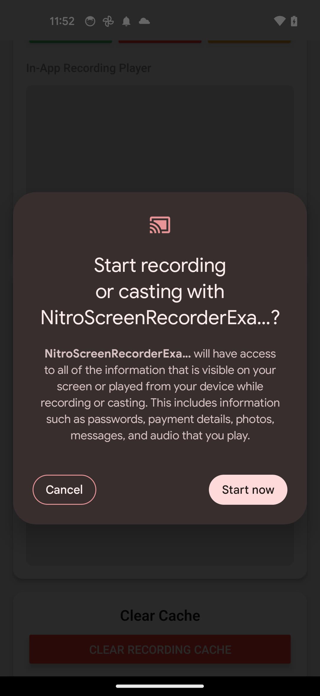

# react-native-nitro-screen-recorder

> ⚠️ This package is currently in alpha and under active development. Please report any issues that you run across on either platform.

A React Native library powered by [NitroModules](https://nitro.margelo.com/) that provides comprehensive screen recording capabilities for both iOS and Android. Capture in-app content or global screen recordings with camera overlay support, audio recording, and extensive customization options.

## Features

- **In-App Recording** (iOS only) - Record your app's content with camera overlay
- **Global Screen Recording** - System-wide screen capture (iOS & Android)
- **Camera Integration** - Front/back camera overlay with customizable positioning
- **Audio Recording** - Microphone support with permission management
- **Event Listeners** - Real-time recording status updates
- **File Management** - Automatic file handling and cache management
- **Permission Management** - Built-in camera and microphone permission handling
- **React Hooks** - Convenient hooks for permissions and global recording management

## Demo

|                          iOS In-App Recording                          |                   iOS Global Recording                    |                     Android Global Recording                      |
| :--------------------------------------------------------------------: | :-------------------------------------------------------: | :---------------------------------------------------------------: |
|  |  |  |

## Installation

Using npm:

```sh
npm install react-native-nitro-screen-recorder react-native-nitro-modules
```

Using yarn:

```sh
yarn add react-native-nitro-screen-recorder react-native-nitro-modules
```

> `react-native-nitro-modules` is required as this library relies on [Nitro Modules](https://nitro.margelo.com/).

## Configuration

This library includes an Expo config plugin for automatic native configuration.

<details>
<summary><h3>Using Expo</h3></summary>

Add the plugin to your `app.config.js` or `app.json`:

```js
export default {
  expo: {
    plugins: [
      [
        'react-native-nitro-screen-recorder',
        {
          enableCameraPermission: true,
          cameraPermissionText:
            'Allow $(PRODUCT_NAME) to access your camera for screen recording with camera overlay',
          enableMicrophonePermission: true,
          microphonePermissionText:
            'Allow $(PRODUCT_NAME) to access your microphone for screen recording with audio',
          iosBroadcastExtensionTargetName: "ScreenRecorder",
          iosAppGroupIdentifier:
            'group.com.yourcompany.yourapp.screenrecording',
          iosExtensionBundleIdentifier:
            'com.yourcompany.yourapp.BroadcastExtension',
          showPluginLogs: false,
        },
      ],
    ],
  },
};
```

#### Plugin Configuration Options

| Option                         | Type      | Platform     | Default                                                                                  | Description                                                                                                                           |
| :----------------------------- | :-------- | :----------- | :--------------------------------------------------------------------------------------- | :------------------------------------------------------------------------------------------------------------------------------------ |
| `enableCameraPermission`       | `boolean` | iOS          | `true`                                                                                   | Whether to enable camera permission for screen recording with camera overlay                                                          |
| `cameraPermissionText`         | `string`  | iOS          | `"Allow $(PRODUCT_NAME) to access your camera for screen recording with camera overlay"` | Camera permission description text displayed in iOS permission dialog                                                                 |
| `enableMicrophonePermission`   | `boolean` | iOS, Android | `true`                                                                                   | Whether to enable microphone permission for screen recording with audio capture                                                       |
| `microphonePermissionText`     | `string`  | iOS          | `"Allow $(PRODUCT_NAME) to access your microphone for screen recording with audio"`      | Microphone permission description text displayed in iOS permission dialog                                                             |
| `disableExperimental`          | `boolean` | iOS          | `false`                                                                                  | Whether to disable the experimental Expo appExtensions configuration. When true, skips applying the broadcast extension configuration |
| `iosBroadcastExtensionTargetName` | `string`  | iOS          | `BroadcastExtension`                                      | The ability to customize the Target Name of the ios Broadcast Extension.
| `iosExtensionBundleIdentifier` | `string`  | iOS          | `"${PRODUCT_BUNDLE_IDENTIFIER}.BroadcastExtension"`                                      | The ability to customize the Broadcast Extension Bundle Identifier.                                                                   |
| `iosAppGroupIdentifier`        | `string`  | iOS          | `"group.${PRODUCT_BUNDLE_IDENTIFIER}.screen-recording"`                                  | App Group identifier used to share data between the main app and its extensions                                                       |
| `showPluginLogs`               | `boolean` | iOS, Android | `false`                                                                                  | Whether to display detailed plugin logs during the build process                                                                      |

</details>

<details>
<summary><h3>Using Bare Workflow (Non-Expo)</h3></summary>

If you're using a bare React Native project (not using Expo), you'll need to manually configure the native iOS and Android projects.

## iOS Setup

### 1. Add Permissions to Info.plist

Add the following permissions to your `ios/YourApp/Info.plist`:

```xml
<key>NSCameraUsageDescription</key>
<string>Allow $(PRODUCT_NAME) to access your camera for screen recording with camera overlay</string>
<key>NSMicrophoneUsageDescription</key>
<string>Allow $(PRODUCT_NAME) to access your microphone for screen recording with audio</string>
```

### 2. Create App Group

1.  Open your project in Xcode
2.  Select your main app target
3.  Go to **Signing & Capabilities**
4.  Click **+ Capability** and add **App Groups**
5.  Create a new app group with identifier: `group.com.yourcompany.yourapp.screenrecording`
6.  Add the App Group identifier to your `Info.plist`:

```xml
<key>AppGroupIdentifier</key>
<string>group.com.yourcompany.yourapp.screenrecording</string>
```

### 3. Create Broadcast Upload Extension

1.  In Xcode, go to **File → New → Target**
2.  Choose **Broadcast Upload Extension**
3.  Name it `BroadcastExtension`
4.  Set the bundle identifier to `com.yourcompany.yourapp.BroadcastExtension`

### 4. Configure Extension Files

1.  Copy `SampleHandler.swift` from `node_modules/react-native-nitro-screen-recorder/plugin/src/ios/SampleHandler.swift` to your `BroadcastExtension/` folder
2.  Copy `BroadcastWriter.swift` from `node_modules/react-native-nitro-screen-recorder/plugin/src/ios/BroadcastWriter.swift` to your `BroadcastExtension/` folder
3.  Update the following values in `SampleHandler.swift`:
    - Replace `<GROUPIDENTIFIER>` with your app group identifier (e.g., `group.com.yourcompany.yourapp.screenrecording`)
    - Replace `<SCHEME>` with your app's custom URL scheme

### 5. Configure Extension Settings

1.  Select the `BroadcastExtension` target in Xcode
2.  Go to **Signing & Capabilities**
3.  Add **App Groups** capability
4.  Select the same app group you created earlier
5.  Set the **Deployment Target** to match your main app
6.  Ensure **ReplayKit.framework** is linked in **Build Phases → Link Binary With Libraries**

### 6. Update Extension Info.plist

Update `BroadcastExtension/Info.plist`:

```xml
<key>NSExtension</key>
<dict>
  <key>NSExtensionPointIdentifier</key>
  <string>com.apple.broadcast-services-upload</string>
  <key>NSExtensionPrincipalClass</key>
  <string>$(PRODUCT_MODULE_NAME).SampleHandler</string>
  <key>RPBroadcastProcessMode</key>
  <string>RPBroadcastProcessModeSampleBuffer</string>
</dict>
<key>AppGroupIdentifier</key>
<string>group.com.yourcompany.yourapp.screenrecording</string>
```

### 7. Create Extension Entitlements

Create `BroadcastExtension/BroadcastExtension.entitlements`:

```xml
<?xml version="1.0" encoding="UTF-8"?>
<!DOCTYPE plist PUBLIC "-//Apple//DTD PLIST 1.0//EN" "http://www.apple.com/DTDs/PropertyList-1.0.dtd">
<plist version="1.0">
<dict>
  <key>com.apple.security.application-groups</key>
  <array>
    <string>group.com.yourcompany.yourapp.screenrecording</string>
  </array>
</dict>
</plist>
```

Then in your extension target's **Build Settings**, set **Code Signing Entitlements** to `BroadcastExtension/BroadcastExtension.entitlements`.

## Android Setup

### 1. Add Permissions to AndroidManifest.xml

Add the following permissions to `android/app/src/main/AndroidManifest.xml`:

```xml
<uses-permission android:name="android.permission.FOREGROUND_SERVICE" />
<uses-permission android:name="android.permission.FOREGROUND_SERVICE_MEDIA_PROJECTION" />
<uses-permission android:name="android.permission.RECORD_AUDIO" />
<uses-permission android:name="android.permission.POST_NOTIFICATIONS" />
```

### 2. Add Service Declaration

Add the screen recording service to your `AndroidManifest.xml` inside the `<application>` tag:

```xml
<service
    android:name="com.margelo.nitro.nitroscreenrecorder.ScreenRecordingService"
    android:enabled="true"
    android:exported="false"
    android:foregroundServiceType="mediaProjection" />
```

### 3. Update MainActivity

Add activity result handling to your `MainActivity.java` or `MainActivity.kt`:

#### For Java (MainActivity.java):

```java
import android.content.Intent;
import com.margelo.nitro.nitroscreenrecorder.NitroScreenRecorder;
import android.util.Log;

@Override
public void onActivityResult(int requestCode, int resultCode, Intent data) {
  super.onActivityResult(requestCode, resultCode, data);
  Log.d("MainActivity", "onActivityResult: requestCode=" + requestCode + ", resultCode=" + resultCode);

  try {
    NitroScreenRecorder.handleActivityResult(requestCode, resultCode, data);
  } catch (Exception e) {
    Log.e("MainActivity", "Error handling activity result: " + e.getMessage());
    e.printStackTrace();
  }
}
```

#### For Kotlin (MainActivity.kt):

```kotlin
import com.margelo.nitro.nitroscreenrecorder.NitroScreenRecorder
import android.content.Intent
import android.util.Log

override fun onActivityResult(requestCode: Int, resultCode: Int, data: Intent?) {
  super.onActivityResult(requestCode, resultCode, data)
  Log.d("MainActivity", "onActivityResult: requestCode=$requestCode, resultCode=$resultCode")

  try {
    NitroScreenRecorder.handleActivityResult(requestCode, resultCode, data);
  } catch (e: Exception) {
    Log.e("MainActivity", "Error handling activity result: ${e.message}")
    e.printStackTrace()
  }
}
```

## Important Notes

- Replace `group.com.yourcompany.yourapp.screenrecording` with your actual app group identifier
- Replace `com.yourcompany.yourapp` with your actual bundle identifier
- Ensure both your main app and broadcast extension have the same App Group configured
- Test thoroughly on physical devices as screen recording doesn't work in simulators
- Make sure your app has a custom URL scheme configured for deep linking

</details>

## Verification

After completing these steps:

1.  Build and run your app on a physical device
2.  Test global screen recording functionality
3.  Verify that recorded files are properly saved and accessible
4.  Check that permissions are properly requested when needed

### Quick Start Example

Here's a complete example using the **new** `useGlobalRecording` hook and updated `stopGlobalRecording`:

```tsx
import React from 'react';
import { View, Text, Button, Alert } from 'react-native';
import {
  useGlobalRecording,
  useMicrophonePermission,
  startGlobalRecording,
  stopGlobalRecording,
} from 'react-native-nitro-screen-recorder';

export default function ScreenRecorderExample() {
  const { hasPermission, requestPermission } = useMicrophonePermission();

  const { isRecording } = useGlobalRecording({
    onRecordingStarted: () => {
      Alert.alert('Recording started');
    },
    onRecordingFinished: async (file) => {
      if (file) {
        Alert.alert(
          'Recording Complete!',
          `Saved: ${file.name}\nDuration: ${file.duration}s\nSize: ${file.size} bytes`
        );
        // e.g., uploadRecording(file.path)
      } else {
        Alert.alert('Recording Complete', 'Failed to retrieve the file.');
      }
    },
    settledTimeMs: 700, // optional delay before retrieving the file
  });

  const handleStartRecording = async () => {
    if (!hasPermission) {
      const granted = await requestPermission();
      if (!granted) {
        Alert.alert(
          'Permission Required',
          'Microphone permission is needed for audio recording'
        );
        return;
      }
    }

    startGlobalRecording({
      options: {
        enableMic: true,
      },
      onRecordingError: (error) => {
        Alert.alert('Global recording error', error.message);
      },
    });
  };

  const handleStopRecording = async () => {
    const file = await stopGlobalRecording({ settledTimeMs: 1000 });
    if (file) {
      console.log('Stopped and retrieved file:', file);
    }
  };

  return (
    <View style={{ flex: 1, justifyContent: 'center', padding: 20 }}>
      <Text style={{ fontSize: 18, marginBottom: 20, textAlign: 'center' }}>
        Screen Recorder Demo
      </Text>

      <Button title="Start Global Recording" onPress={handleStartRecording} />
      <Button title="Stop Recording" onPress={handleStopRecording} />

      {isRecording && (
        <Text style={{ marginTop: 10 }}>Recording is active…</Text>
      )}
    </View>
  );
}
```

# Documentation

## Table of Contents

- [React Hooks](#react-hooks)
  - [`useCameraPermission()`](#usecamerapermission-permissionstate)
  - [`useMicrophonePermission()`](#usemicrophonepermission-permissionstate)
  - [`useGlobalRecording()`](#useglobalrecordinginput--globalrecordinghookoutput)
- [Permissions](#permissions)
  - [`getCameraPermissionStatus()`](#getcamerapermissionstatus-permissionstatus)
  - [`getMicrophonePermissionStatus()`](#getmicrophonepermissionstatus-permissionstatus)
  - [`requestCameraPermission()`](#requestcamerapermission-promisepermissionresponse)
  - [`requestMicrophonePermission()`](#requestmicrophonepermission-promisepermissionresponse)
- [In-App Recording](#in-app-recording)
  - [`startInAppRecording()`](#startinapprecordinginput-promisevoid)
  - [`stopInAppRecording()`](#stopinapprecording-promisescreenrecordingfile--undefined)
  - [`cancelInAppRecording()`](#cancelinapprecording-promisevoid)
- [Screen Recording Consent](#screen-recording-consent)
  - [`requestScreenRecordingConsent()`](#requestscreenrecordingconsent-promiseboolean)
  - [`releaseScreenRecordingConsent()`](#releasescreenrecordingconsent-void)
  - [`isScreenRecordingConsentGranted()`](#isscreenrecordingconsentgranted-boolean)
  - [`getScreenRecordingSessionState()`](#getscreenrecordingsessionstate-screenrecordingsessionstate)
- [Global Recording](#global-recording)
  - [`startGlobalRecording()`](#startglobalrecordinginput-void)
  - [`stopGlobalRecording()`](#stopglobalrecording-promisescreenrecordingfile--undefined)
  - [`retrieveLastGlobalRecording()`](#retrievelastglobalrecording-screenrecordingfile--undefined)
- [Event Listeners](#event-listeners)
  - [`addScreenRecordingListener()`](#addscreenrecordinglistenerlistener-number)
  - [`removeScreenRecordingListener(id): void`](#removescreenrecordinglistenerid-void)
- [Utilities](#utilities)
  - [`clearRecordingCache()`](#clearrecordingcache-void)

## React Hooks

### `useCameraPermission(): PermissionState`

Returns whether the user has granted permission to use the Camera, or not. If the user doesn't grant Camera Permission, you cannot use camera overlay features.

**Platform:** iOS, Android

**Returns:** Object with `hasPermission` boolean and `requestPermission` function

**Example:**

```tsx
import { useCameraPermission } from 'react-native-nitro-screen-recorder';

const { hasPermission, requestPermission } = useCameraPermission();

if (!hasPermission) {
  return <PermissionScreen onPress={requestPermission} />;
} else {
  return <CameraRecordingScreen />;
}
```

### `useMicrophonePermission(): PermissionState`

Returns whether the user has granted permission to use the Microphone, or not. If the user doesn't grant Audio Permission, you can still record but without audio.

**Platform:** iOS, Android

**Returns:** Object with `hasPermission` boolean and `requestPermission` function

**Example:**

```tsx
import { useMicrophonePermission } from 'react-native-nitro-screen-recorder';

const { hasPermission: canRecordAudio, requestPermission } =
  useMicrophonePermission();

// Use in recording configuration
const recordingOptions = {
  enableMic: canRecordAudio,
  enableCamera: true,
  // ... other options
};
```

### `useGlobalRecording(input): GlobalRecordingHookOutput`

React hook for monitoring and responding to global screen recording events.

**Platform:** iOS, Android

**Parameters:**

- `onRecordingStarted?: () => void` — Called when a global recording begins.
- `onRecordingFinished?: (file?: ScreenRecordingFile) => void` — Called after recording ends (with a delay to allow the file to settle).
- `onBroadcastPickerShown?: () => void` — Called when the broadcast picker on ios is shown.
- `onBroadcastPickerDismissed?: () => void` — Called with the broadcast picker on ios is dismissed.
- `ignoreRecordingsInitiatedElsewhere?: boolean - `iOS-only`allows the listener to only callback when the`startGlobalRecording` is called.
- `settledTimeMs?: number` — Milliseconds to wait after recording end before attempting to retrieve the file. Defaults to 500.

**Returns:** `{ isRecording: boolean }` — whether a global recording is currently active.

**Example:**

```tsx
import { useGlobalRecording } from 'react-native-nitro-screen-recorder';

const { isRecording } = useGlobalRecording({
  onRecordingStarted: () => console.log('started'),
  onRecordingFinished: (file) => {
    if (file) {
      console.log('finished:', file.path);
    }
  },
  onBroadcastPickerShown: () => {
    console.log('Perform some action');
  },
  onBroadcastPickerDismissed: () => {
    console.log('Perform some other action');
  },
  ignoreRecordingsInitiatedElsewhere: false,
  settledTimeMs: 600,
});
```

## Permissions

### `getCameraPermissionStatus(): PermissionStatus`

Gets the current camera permission status without requesting permission.

**Platform:** iOS, Android

**Returns:** The current permission status for camera access

**Example:**

```ts
import { getCameraPermissionStatus } from 'react-native-nitro-screen-recorder';

const status = getCameraPermissionStatus();
if (status === 'granted') {
  // Camera is available
}
```

### `getMicrophonePermissionStatus(): PermissionStatus`

Gets the current microphone permission status without requesting permission.

**Platform:** iOS, Android

**Returns:** The current permission status for microphone access

**Example:**

```ts
import { getMicrophonePermissionStatus } from 'react-native-nitro-screen-recorder';

const status = getMicrophonePermissionStatus();
if (status === 'granted') {
  // Microphone is available
}
```

### `requestCameraPermission(): Promise<PermissionResponse>`

Requests camera permission from the user if not already granted. Shows the system permission dialog if permission hasn't been determined.

**Platform:** iOS, Android

**Returns:** Promise that resolves with the permission response

**Example:**

```ts
import { requestCameraPermission } from 'react-native-nitro-screen-recorder';

const response = await requestCameraPermission();
if (response.status === 'granted') {
  // Permission granted, can use camera
}
```

### `requestMicrophonePermission(): Promise<PermissionResponse>`

Requests microphone permission from the user if not already granted. Shows the system permission dialog if permission hasn't been determined.

**Platform:** iOS, Android

**Returns:** Promise that resolves with the permission response

**Example:**

```ts
import { requestMicrophonePermission } from 'react-native-nitro-screen-recorder';

const response = await requestMicrophonePermission();
if (response.status === 'granted') {
  // Permission granted, can record audio
}
```

## In-App Recording

### `startInAppRecording(input): Promise<void>`

Starts in-app screen recording with the specified configuration. Records only the current app's content, not system-wide screen content.

**Platform:** iOS only

**Parameters:**

- `options.enableMic`: boolean - Whether to enable microphone audio
- `options.enableCamera`: boolean - Whether to enable camera overlay
- `options.cameraPreviewStyle`: RecorderCameraStyle - Camera positioning and styling
- `options.cameraDevice`: CameraDevice - Front or back camera
- `onRecordingFinished`: (file: ScreenRecordingFile) => void - Callback when recording completes

**Example:**

```ts
import { startInAppRecording } from 'react-native-nitro-screen-recorder';

await startInAppRecording({
  options: {
    enableMic: true,
    enableCamera: true,
    cameraPreviewStyle: { width: 100, height: 150, top: 30, left: 10 },
    cameraDevice: 'front',
  },
  onRecordingFinished: (file) => {
    console.log('Recording saved:', file.path);
  },
});
```

### `stopInAppRecording(): Promise<ScreenRecordingFile | undefined>`

Stops the current in-app recording and returns the recorded video file. The recording file is also provided through the onRecordingFinished callback.

**Platform:** iOS only

**Returns:** Promise that resolves with the recording file or undefined if no recording was active

**Example:**

```ts
import { stopInAppRecording } from 'react-native-nitro-screen-recorder';

const file = await stopInAppRecording();
if (file) {
  console.log('Recording stopped and saved:', file.path);
}
```

### `cancelInAppRecording(): Promise<void>`

Cancels the current in-app recording without saving the video. No file will be generated and onRecordingFinished will not be called.

**Platform:** iOS only

**Example:**

```ts
import { cancelInAppRecording } from 'react-native-nitro-screen-recorder';

await cancelInAppRecording(); // Recording discarded, no file saved
```

## Screen Recording Consent

### `requestScreenRecordingConsent(): Promise<boolean>`

Requests Android screen-capture consent before recording starts and prepares a session for later use.

**Platform:** Android only. On iOS this resolves to `true` as a compatibility no-op.

**Returns:** Promise that resolves with `true` when a prepared session is available.

**Example:**

```ts
import { requestScreenRecordingConsent } from 'react-native-nitro-screen-recorder';

const prepared = await requestScreenRecordingConsent();
if (prepared) {
  // Later, call startGlobalRecording with usePreparedConsent: true.
}
```

### `releaseScreenRecordingConsent(): void`

Releases a prepared Android screen recording session if the user cancels the flow before recording starts.

**Platform:** Android only. On iOS this is a compatibility no-op.

**Example:**

```ts
import { releaseScreenRecordingConsent } from 'react-native-nitro-screen-recorder';

releaseScreenRecordingConsent();
```

### `isScreenRecordingConsentGranted(): boolean`

Returns whether an Android prepared or active screen recording session exists.

**Platform:** Android only. On iOS this returns `false`.

**Example:**

```ts
import { isScreenRecordingConsentGranted } from 'react-native-nitro-screen-recorder';

const hasPreparedSession = isScreenRecordingConsentGranted();
```

### `getScreenRecordingSessionState(): ScreenRecordingSessionState`

Returns the current screen recording session state.

**Platform:** iOS, Android

**Returns:** `"idle"`, `"prepared"`, or `"recording"`. iOS always returns `"idle"`.

**Example:**

```ts
import { getScreenRecordingSessionState } from 'react-native-nitro-screen-recorder';

const state = getScreenRecordingSessionState();
```

## Global Recording

### `startGlobalRecording(input): void`

Starts global screen recording that captures the entire device screen. Records system-wide content, including other apps and system UI.

**Platform:** iOS, Android

**Parameters:**

- `options.enableMic`: boolean - Whether to enable microphone audio
- `options.usePreparedConsent?: boolean` - Android only. When `true`, starts from a session created by `requestScreenRecordingConsent()` instead of showing the system consent dialog.
- `onRecordingError`: (error: RecordingError) => void - Error callback

**Throws:**

- `Error`: If microphone permission is not granted on Android when `enableMic` is `true`.

When `usePreparedConsent` is `true` but no prepared Android session exists, `onRecordingError` receives `PreparedConsentNotAvailable`. The default is `false`, so existing calls keep the original system prompt behavior.

**Example:**

```ts
import { startGlobalRecording } from 'react-native-nitro-screen-recorder';

startGlobalRecording({
  options: {
    enableMic: true,
  },
  onRecordingError: (error) => {
    console.error('Global recording error:', error.message);
  },
});
```

**Prepared consent example (Android only):**

```ts
import {
  requestScreenRecordingConsent,
  startGlobalRecording,
} from 'react-native-nitro-screen-recorder';

const prepared = await requestScreenRecordingConsent();
if (prepared) {
  startGlobalRecording({
    options: {
      enableMic: true,
      usePreparedConsent: true,
    },
    onRecordingError: (error) => {
      console.error('Global recording error:', error.message);
    },
  });
}
```

### `stopGlobalRecording(options?): Promise<ScreenRecordingFile | undefined>`

Stops the current global screen recording and returns the saved video file. Because the system may take a short moment to finalize the asset writer output, you can pass an optional delay before retrieval.

**Platform:** iOS, Android

**Parameters:**

- `options.settledTimeMs?: number` — Milliseconds to wait after the broadcast ends before attempting to retrieve the file. Defaults to 500.

**Example:**

```ts
import { stopGlobalRecording } from 'react-native-nitro-screen-recorder';

const file = await stopGlobalRecording({ settledTimeMs: 1000 });
if (file) {
  console.log('Global recording saved:', file.path);
}
```

### `retrieveLastGlobalRecording(): ScreenRecordingFile | undefined`

Retrieves the most recently completed global recording file. Returns undefined if no global recording has been completed.

**Platform:** iOS, Android

**Returns:** The last global recording file or undefined if none exists

**Example:**

```ts
import { retrieveLastGlobalRecording } from 'react-native-nitro-screen-recorder';

const lastRecording = retrieveLastGlobalRecording();
if (lastRecording) {
  console.log('Duration:', lastRecording.duration);
  console.log('File size:', lastRecording.size);
}
```

## Event Listeners

### `addScreenRecordingListener(listener): () => void`

Adds a listener for screen recording events (began, ended, etc.). Returns a cleanup function to remove the listener when no longer needed.

**Platform:** iOS, Android

**Parameters:**

- `listener`: Callback function that receives screen recording events
- `ignoreRecordingsInitiatedElsewhere?: boolean - `iOS-only` allows the listener to only callback when the`startGlobalRecording` is called.

**Returns:** Cleanup function to remove the listener

**Example:**

```ts
import { useEffect } from 'react';
import { addScreenRecordingListener } from 'react-native-nitro-screen-recorder';

useEffect(() => {
  const removeListener = addScreenRecordingListener({
    ignoreRecordingsInitiatedElsewhere: false,
    listener: (event) => {
      console.log('Event type:', event.type, 'Event reason:', event.reason);
    },
  });

  // Clean up listener when component unmounts
  return removeListener;
}, []);
```

### `addBroadcastPickerListener(listener): () => void`

Adds a listener for iOS broadcast picker status changes (showing & dismissed). Returns a cleanup function to remove the listener when no longer needed. This helps when trying to perform some action on iOS as soon as the broadcast picker is dismissed.

**Platform:** iOS only (returns no-op cleanup function on Android)

**Parameters:**

- `listener`: Callback function that receives broadcast picker presentation events

**Returns:** Cleanup function to remove the listener

**Example:**

```ts
import { useEffect } from 'react';
import { addBroadcastPickerListener } from 'react-native-nitro-screen-recorder';

useEffect(() => {
  const removeListener = addBroadcastPickerListener((event) => {
    console.log('Picker status:', event);

    switch (event) {
      case 'showing':
        console.log('Broadcast picker is showing');
        break;
      case 'dismissed':
        console.log(
          'Broadcast picker was dismissed without starting recording'
        );
        break;
    }
  });

  // Clean up listener when component unmounts
  return removeListener;
}, []);
```

**Event Types:**

- `showing`: The broadcast picker modal is displayed to the user
- `dismissed`: The broadcast modal was dismissed without starting recording

## Utilities

### `clearRecordingCache(): void`

Clears all cached recording files to free up storage space. This will delete temporary files but not files that have been explicitly saved.

**Platform:** iOS, Android

**Example:**

```ts
import { clearRecordingCache } from 'react-native-nitro-screen-recorder';

clearRecordingCache(); // Frees up storage by removing temporary recording files
```

## Types

The library exports comprehensive TypeScript types for all functionality:

```ts
// Permission types
export type PermissionStatus = 'denied' | 'granted' | 'undetermined';

export type PermissionResponse = {
  canAskAgain: boolean;
  granted: boolean;
  status: PermissionStatus;
  expiresAt: never | number;
};

// Hook types
export interface PermissionState {
  hasPermission: boolean;
  requestPermission: () => Promise<boolean>;
}

export type GlobalRecordingHookInput = {
  onRecordingStarted?: () => void;
  onRecordingFinished?: (file?: ScreenRecordingFile) => void;
  settledTimeMs?: number;
};

export type GlobalRecordingHookOutput = {
  isRecording: boolean;
};

// Recording configuration
export type RecorderCameraStyle = {
  top?: number;
  left?: number;
  width?: number;
  height?: number;
  borderRadius?: number;
  borderWidth?: number;
};

export type CameraDevice = 'front' | 'back';

// Recording file information
export interface ScreenRecordingFile {
  path: string;
  name: string;
  size: number;
  duration: number;
  enabledMicrophone: boolean;
}

// Event types
export interface ScreenRecordingEvent {
  type: 'global' | 'withinApp';
  reason: 'began' | 'ended';
}

export interface RecordingError {
  name: string;
  message: string;
}
```

## Platform Differences

### iOS

- **In-App Recording**: Full support with camera overlay
- **Global Recording**: Full programmatic control including start and stop functionality
- **Permissions**: Camera and microphone permissions handled automatically
- **App Extensions**: Uses broadcast extensions for global recording

### Android

- **In-App Recording**: Not supported (use global recording instead)
- **Global Recording**: Full programmatic control including stop functionality
- **Permissions**: Microphone permission required for audio recording
- **Media Projection**: Uses Android's MediaProjection API

## Contributing

See the [contributing guide](CONTRIBUTING.md) to learn how to contribute to the repository and the development workflow.

## License

MIT

---

Made with [create-react-native-library](https://github.com/callstack/react-native-builder-bob)
